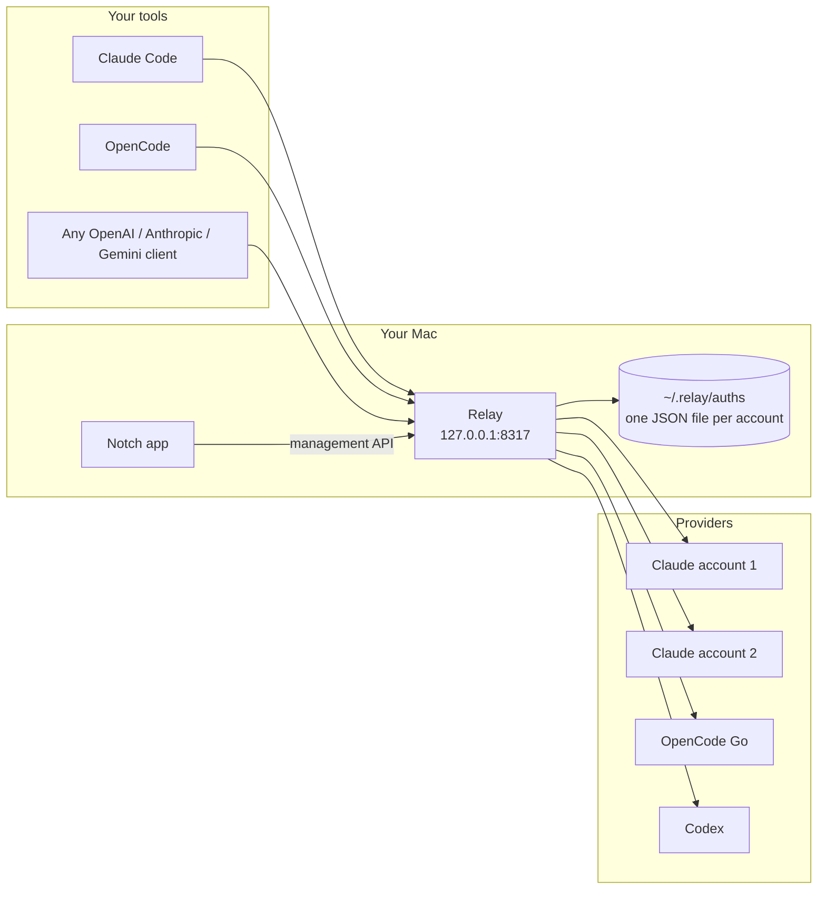

# Relay

Relay keeps your coding agent working when an AI plan hits its limit. It runs
on your Mac at `127.0.0.1:8317`, holds the subscriptions you already pay for
(Claude Pro or Max, ChatGPT through Codex, OpenCode Go and a few others), and
serves them to any tool that speaks the OpenAI, Anthropic, or Gemini API. When
one account runs out, the next request goes to another account, or to another
plan in the fallback order you set.

You don't set it up by hand: you ask your coding agent to, and it uses Relay's
command line (`relay setup`, `relay status`, `relay doctor`). An optional app
in the Mac's notch shows what is left.

Relay is a personal project built on top of
[CLIProxyAPI](https://github.com/router-for-me/CLIProxyAPI). Most of the proxy is
their work. See [Credits](#credits) for what came from where.

## How it works



1. A tool sends a request to Relay in whichever format it speaks.
2. Relay picks the next healthy account for that model, translates the request
   into the provider's format, and sends it.
3. If the provider answers with a rate limit (HTTP 429), Relay marks that
   account as cooling down and retries on another one. When every account of
   that provider is out, a fallback chain moves the request to the next plan,
   for example from Claude to OpenCode Go.
4. Relay reads the limit headers on every response. The notch app shows them.

## Accounts

| Account | Sign in | Tested in Relay |
| --- | --- | --- |
| Claude (Pro, Max) | `relay accounts add claude` | Yes, daily use with three accounts |
| OpenCode Go | `relay accounts add opencode-go` (API key) | Yes, chat, streaming, tool calls, limits |
| Codex (ChatGPT plans) | `relay accounts add codex` | No, comes from CLIProxyAPI |
| Kimi | `relay accounts add kimi` | No, comes from CLIProxyAPI |
| xAI | `relay accounts add xai` | No, comes from CLIProxyAPI |
| Devin | `relay accounts add devin` | No, comes from CLIProxyAPI |
| Meta | `relay accounts add meta` | No, comes from CLIProxyAPI |

Relay turns off the Google providers that CLIProxyAPI has (Gemini, Gemini CLI,
Vertex, AI Studio, Antigravity). Clients can still call Relay with the Gemini
request format; Relay translates it for the accounts above.

OpenCode Go models show up as `opencode-go/<model>`, for example
`opencode-go/deepseek-v4.1-flash`. Relay asks OpenCode Go for its model list on
start and every hour. A fallback chain can also serve another model name with
an OpenCode Go model.

## What is tested

Checked against a running Relay on 10 Nov 2026, with Claude and OpenCode Go
accounts:

| Feature | Result |
| --- | --- |
| OpenAI chat completions (plain, streaming, tool calls) | Works |
| Anthropic messages (plain, streaming, tool use, `count_tokens`, `x-api-key`) | Works |
| OpenAI Responses API (plain and streaming) | Works |
| Gemini `generateContent` and `streamGenerateContent` into Claude | Works |
| Thinking level in the model name, like `claude-sonnet-4-6(low)` | Works |
| OpenCode Go through the OpenAI and Anthropic formats, with tools | Works |
| Rotation across accounts, skipping a rate-limited one | Works |
| Wrong or missing client key | Rejected with 401 |
| Management API with a wrong key | Rejected with 401 |
| `relay setup` on an empty folder, then again (changes nothing) | Works |
| `relay doctor` and `relay status` on a real install | Works |
| `relay accounts add opencode-go` with a good key, and a bad key | Saved; rejected and nothing saved |
| `relay accounts add claude` link, then Ctrl-C | Link printed; sign-in cancelled |
| `relay fallback set` with Claude failing: request answered by OpenCode Go | Works |
| `go test ./...` and `swift build` | Pass |

## Set up

Paste this into Claude Code, Codex, or any coding agent:

```text
Set up Relay for me by following the "Agent setup" section of https://github.com/udit19199/relay
```

The agent installs Relay, starts it, and points your tool at it. You only
finish each account sign-in in your browser.

### Agent setup

Steps for the agent. Every command accepts `--json`, prints one JSON object
per line, and exits non-zero on failure. `relay help` lists every flag.

1. Check that this is macOS and that `go version` reports 1.26 or newer.
2. Build Relay:

   ```bash
   git clone https://github.com/udit19199/relay.git ~/.relay-src 2>/dev/null || git -C ~/.relay-src pull
   mkdir -p ~/.local/bin && cd ~/.relay-src && go build -o ~/.local/bin/relay ./cmd/server
   ```

3. Run `~/.local/bin/relay setup --json`. It creates `~/.relay` with a config
   and keys, installs the login service, starts Relay, and returns `base_url`,
   `client_key`, and the environment lines for Claude Code and OpenAI-style
   tools. Running it again changes nothing. If port 8317 is taken, pass
   `--port <n>`.
4. Ask the user before changing their tool's settings. For Claude Code, add
   the two values from `claude_code_env` to the `env` object in
   `~/.claude/settings.json`, keeping every other key (create the file if it
   does not exist):

   ```json
   { "env": { "ANTHROPIC_BASE_URL": "http://127.0.0.1:8317", "ANTHROPIC_AUTH_TOKEN": "<client_key>" } }
   ```
5. Add accounts. `relay accounts add claude --json --no-browser` (or `codex`,
   `kimi`, `xai`, `devin`, `meta`) prints a `{"event":"sign_in_link","url":...}`
   line, waits up to 5 minutes, then prints the result line. Give the link to
   the user; the user signs in. For OpenCode Go, ask the user to run
   `OPENCODE_API_KEY=... relay accounts add opencode-go` themselves, so the key
   never appears in the chat.
6. Ask which order to fall back in, then set it. For example, to keep Claude
   Code on Opus and continue on other plans when every Claude account is out:

   ```bash
   relay fallback set claude-opus-5-5 claude codex:gpt-6-sol opencode-go:deepseek-v4.1-flash
   ```

7. Run `relay doctor --json` and apply the `fix` of every check with level
   `fail`. Then report `relay status` to the user.

Rules for the agent: never print `~/.relay/management.key` or credential
files, never ask the user to paste a key or token into the chat, and never
complete a sign-in for the user.

### Commands

| Command | What it does |
| --- | --- |
| `relay setup` | Creates `~/.relay`, keys, and the login service, then starts Relay. Safe to rerun. |
| `relay status` | Accounts, how much of each limit is left, and fallback chains. |
| `relay doctor` | Checks config, keys, the proxy, the login service, and every account, with a fix for each problem. |
| `relay accounts add <provider>` | Browser sign-in for `claude`, `codex`, `kimi`, `xai`, `devin`, `meta`; API key for `opencode-go`. |
| `relay accounts remove <name>` | Deletes a credential. |
| `relay fallback set <model> <provider>[:<model>] ...` | Serves `<model>` from the first provider in the list that has capacity. |
| `relay fallback clear <model>` | Removes a chain. |
| `relay --config ~/.relay/config.yaml` | Runs the proxy in the foreground instead of the login service. |

To stop the login service: `launchctl bootout gui/$(id -u)/com.relay.proxy`.
`relay setup` starts it again. Setting `RELAY_HOME` moves `~/.relay` to another
folder; such installs never use the login service.

### How fallback works

`relay fallback set` uses two features the proxy already has. Each account in
the chain gets a priority (first in the list is highest), and the router always
uses the highest-priority account that is not rate limited. Providers that name
the model differently get an alias, so `codex:gpt-6-sol` means "answer requests
for this model with `gpt-6-sol`". When the first provider's accounts recover,
new requests go back to it.

If two chains list the same providers in different orders, the last one set
wins, because priority belongs to the account, not the model.

## Point your tools at Relay

`relay setup` prints these values. By hand:

```bash
# Claude Code
export ANTHROPIC_BASE_URL=http://127.0.0.1:8317
export ANTHROPIC_AUTH_TOKEN=<client_key>

# OpenAI-style tools
export OPENAI_BASE_URL=http://127.0.0.1:8317/v1
export OPENAI_API_KEY=<client_key>
```

The notch app is optional. Build it with
`cd notch && ./scripts/package-local-app.sh` and copy
`.build/release/Relay.app` to `/Applications`.

## Notch app

The notch app talks to Relay only through its management API on
`127.0.0.1:8317`. It never reads or writes credential files itself.

- The island shows the pooled 5-hour and weekly limit left across your Claude
  accounts. Hover to open it and see each account with its reset time.
- OpenCode Go has its own section with its rolling, weekly, and monthly limits.
- Add Account opens Relay's browser sign-in. Remove deletes the credential from
  Relay, which cuts off every tool using it.

On a Mac without a notch it shows as a small floating capsule at the top of the
screen.

## Before you use it

Relay sends requests to Claude, ChatGPT, and the others with your own account's
sign-in, the same way their official command line tools do. Providers may not
allow this in their terms, and they can limit or close accounts that do it. Use
accounts you are willing to risk.

Relay is meant for one person on one Mac. Keep `host` at `127.0.0.1` unless you
know why you are changing it.

## Credits

Relay would not exist without these projects:

- **[CLIProxyAPI](https://github.com/router-for-me/CLIProxyAPI)** by Luis Pater,
  Router-For.ME, and its contributors (MIT). The proxy, the protocol
  translation, the provider sign-ins, account rotation, the 429 retry, and the
  management API all come from it. Relay's git history keeps their commits.
- **[Codex Account Switcher](https://github.com/liuzhao1225/codex-account-switcher)**
  by liuzhao1225 (MIT). The notch app started as a fork of this Mac app, and
  its history is merged into `notch/`.
- **[vorssaint-utils](https://github.com/vorssaint/vorssaint-utils)** by
  Vorssaint (GPL-3.0-or-later). The notch shape and island placement code is
  copied from it; those files carry its license header.

What Relay adds on top:

- A command line made for coding agents: `relay setup`, `status`, `doctor`,
  `accounts`, and `fallback`, each with `--json` output.
- Fallback chains across plans, built on CLIProxyAPI's credential priority and
  model aliases.
- OpenCode Go as a built-in account: limits, model list, and requests, with no
  plugin or config block.
- The notch app rebuilt as a client of the proxy: pooled limits across
  accounts, per-account resets, adding and removing accounts.
- Google providers and Antigravity turned off.

I wrote Relay with coding agents doing a lot of the typing, under my direction.

## License

The proxy is MIT licensed, see [LICENSE](LICENSE). The notch app in `notch/`
is GPL-3.0-or-later as a whole, because it includes GPL code from
vorssaint-utils. See [notch/README.md](notch/README.md#license).
