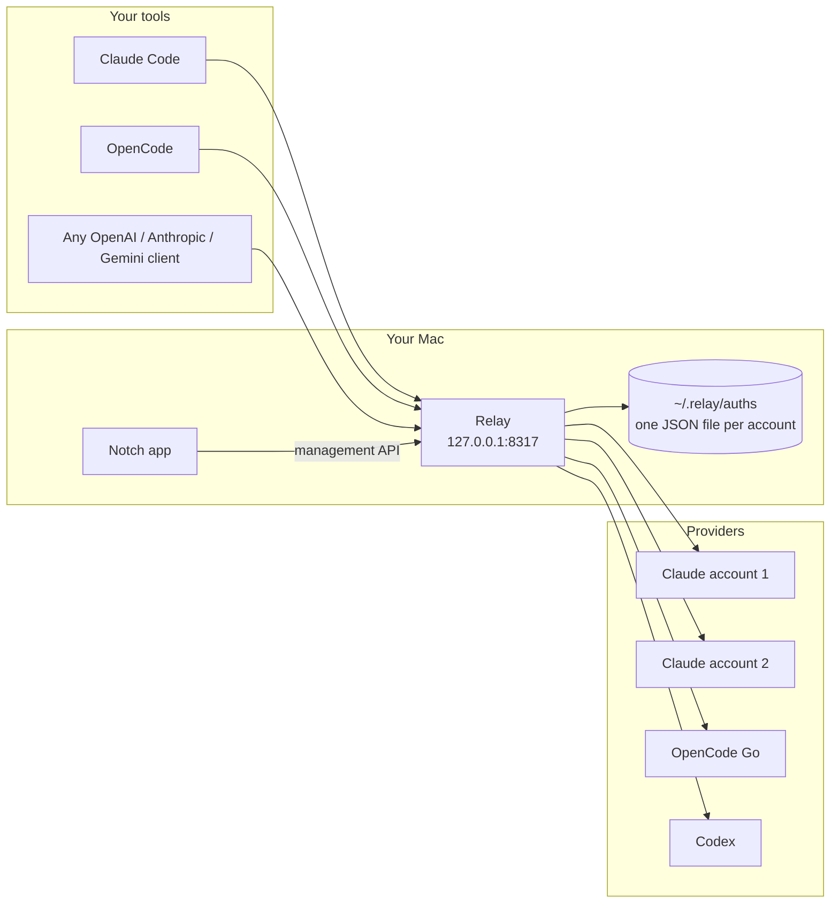

# Relay

Relay lets you use the AI subscriptions you already pay for (Claude Pro or Max,
ChatGPT through Codex, OpenCode Go and a few others) from any tool that speaks
the OpenAI, Anthropic, or Gemini API. It runs on your Mac at `127.0.0.1:8317`,
holds every account you sign in with, and spreads requests across them, so one
account hitting its limit does not stop your work.

A small app in the Mac's notch shows how much of each account's 5-hour and
weekly limit is left, and lets you add or remove accounts.

Relay is a personal project built on top of
[CLIProxyAPI](https://github.com/router-for-me/CLIProxyAPI). Most of the proxy is
their work. See [Credits](#credits) for what came from where.

## How it works



1. A tool sends a request to Relay in whichever format it speaks.
2. Relay picks the next healthy account for that model, translates the request
   into the provider's format, and sends it.
3. If the provider answers with a rate limit (HTTP 429), Relay marks that
   account as cooling down and retries on another one.
4. Relay reads the limit headers on every response. The notch app shows them.

## Accounts

| Account | Sign in | Tested in Relay |
| --- | --- | --- |
| Claude (Pro, Max) | `--claude-login` or the notch app | Yes, daily use with three accounts |
| OpenCode Go | API key in an auth file or the notch app | Yes, chat, streaming, tool calls, limits |
| Codex (ChatGPT plans) | `--codex-login` or `--codex-device-login` | No, comes from CLIProxyAPI |
| Kimi | `--kimi-login`, `--kimi-ai-login` | No, comes from CLIProxyAPI |
| xAI | `--xai-login` | No, comes from CLIProxyAPI |
| Devin | `--devin-login` | No, comes from CLIProxyAPI |
| Meta | `--meta-login` | No, comes from CLIProxyAPI |

Relay turns off the Google providers that CLIProxyAPI has (Gemini, Gemini CLI,
Vertex, AI Studio, Antigravity). Clients can still call Relay with the Gemini
request format; Relay translates it for the accounts above.

OpenCode Go models show up as `opencode-go/<model>`, for example
`opencode-go/deepseek-v4.1-flash`. Relay asks OpenCode Go for its model list on
start and every hour.

## What is tested

Checked against a running Relay on 10 Nov 2026, with Claude and OpenCode Go
accounts:

| Feature | Result |
| --- | --- |
| OpenAI chat completions (plain, streaming, tool calls) | Works |
| Anthropic messages (plain, streaming, tool use, `count_tokens`, `x-api-key`) | Works |
| OpenAI Responses API (plain and streaming) | Works |
| Gemini `generateContent` and `streamGenerateContent` into Claude | Works |
| Thinking level in the model name, like `claude-sonnet-4-6(low)` | Works |
| OpenCode Go through the OpenAI and Anthropic formats, with tools | Works |
| Rotation across accounts, skipping a rate-limited one | Works |
| Wrong or missing client key | Rejected with 401 |
| Management API with a wrong key | Rejected with 401 |
| `go test ./...` and `swift build` | Pass |

## Install

You need macOS, Go 1.26 or newer, and Xcode command line tools (for the notch
app). There are no prebuilt downloads yet.

1. Build Relay:

   ```bash
   git clone https://github.com/udit19199/relay.git
   cd relay
   go build -o ~/.local/bin/relay ./cmd/server
   ```

2. Create `~/.relay/config.yaml`. Pick two long random strings: one for your
   tools (client key), one for the notch app (management key).

   ```yaml
   config-version: 8
   server:
     host: "127.0.0.1"
     port: 8317
   access:
     api-keys:
       - "CLIENT_KEY"
   management:
     secret-key: "MANAGEMENT_KEY"
   oauth:
     auth-dir: "~/.relay/auths"
   ```

   [`config.example.yaml`](config.example.yaml) lists every other option.

3. Save the management key for the notch app before the first start. Relay
   replaces the plain key in `config.yaml` with a hash when it starts, so this
   is your only copy.

   ```bash
   printf '%s' 'MANAGEMENT_KEY' > ~/.relay/management.key
   chmod 600 ~/.relay/management.key
   ```

4. Start Relay:

   ```bash
   relay --config ~/.relay/config.yaml
   ```

   To keep it running after login, put the same command in a LaunchAgent
   (`~/Library/LaunchAgents/com.relay.proxy.plist`).

5. Sign in to an account. This opens your browser:

   ```bash
   relay --config ~/.relay/config.yaml --claude-login
   ```

   Run it again to add a second Claude account. For OpenCode Go, write
   `~/.relay/auths/opencode-go.json`:

   ```json
   { "type": "opencode-go", "api_key": "YOUR_OPENCODE_GO_KEY" }
   ```

6. Build and open the notch app:

   ```bash
   cd notch
   ./scripts/package-local-app.sh
   cp -R .build/release/Relay.app /Applications/
   open /Applications/Relay.app
   ```

   The app is signed only for your own Mac, so build it yourself rather than
   copying the bundle to another machine.

## Point your tools at Relay

Claude Code:

```bash
export ANTHROPIC_BASE_URL=http://127.0.0.1:8317
export ANTHROPIC_AUTH_TOKEN=CLIENT_KEY
```

OpenAI-style tools:

```bash
export OPENAI_BASE_URL=http://127.0.0.1:8317/v1
export OPENAI_API_KEY=CLIENT_KEY
```

Check that it works:

```bash
curl http://127.0.0.1:8317/v1/models -H "Authorization: Bearer CLIENT_KEY"
```

## Notch app

The notch app talks to Relay only through its management API on
`127.0.0.1:8317`. It never reads or writes credential files itself.

- The island shows the pooled 5-hour and weekly limit left across your Claude
  accounts. Hover to open it and see each account with its reset time.
- OpenCode Go has its own section with its rolling, weekly, and monthly limits.
- Add Account opens Relay's browser sign-in. Remove deletes the credential from
  Relay, which cuts off every tool using it.

On a Mac without a notch it shows as a small floating capsule at the top of the
screen.

## Before you use it

Relay sends requests to Claude, ChatGPT, and the others with your own account's
sign-in, the same way their official command line tools do. Providers may not
allow this in their terms, and they can limit or close accounts that do it. Use
accounts you are willing to risk.

Relay is meant for one person on one Mac. Keep `host` at `127.0.0.1` unless you
know why you are changing it.

## Credits

Relay would not exist without these projects:

- **[CLIProxyAPI](https://github.com/router-for-me/CLIProxyAPI)** by Luis Pater,
  Router-For.ME, and its contributors (MIT). The proxy, the protocol
  translation, the provider sign-ins, account rotation, the 429 retry, and the
  management API all come from it. Relay's git history keeps their commits.
- **[Codex Account Switcher](https://github.com/liuzhao1225/codex-account-switcher)**
  by liuzhao1225 (MIT). The notch app started as a fork of this Mac app, and
  its history is merged into `notch/`.
- **[vorssaint-utils](https://github.com/vorssaint/vorssaint-utils)** by
  Vorssaint (GPL-3.0-or-later). The notch shape and island placement code is
  copied from it; those files carry its license header.

What Relay adds on top:

- OpenCode Go as a built-in account: limits, model list, and requests, with no
  plugin or config block.
- The notch app rebuilt as a client of the proxy: pooled limits across
  accounts, per-account resets, adding and removing accounts.
- Google providers and Antigravity turned off.

I wrote Relay with coding agents doing a lot of the typing, under my direction.

## License

The proxy is MIT licensed, see [LICENSE](LICENSE). The notch app in `notch/`
is GPL-3.0-or-later as a whole, because it includes GPL code from
vorssaint-utils. See [notch/README.md](notch/README.md#license).
